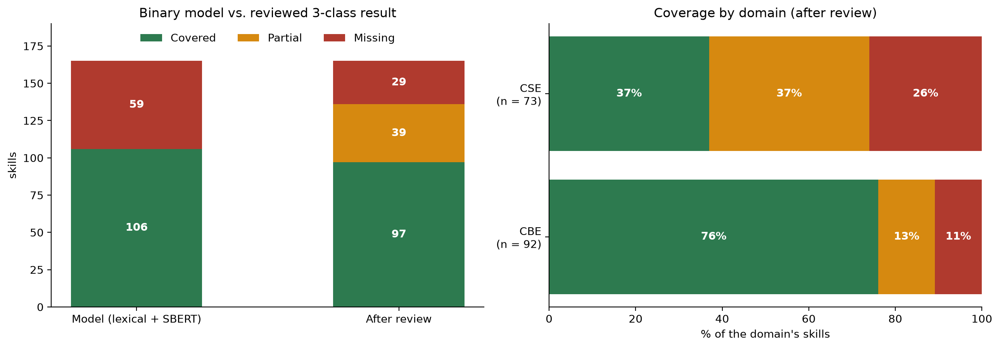
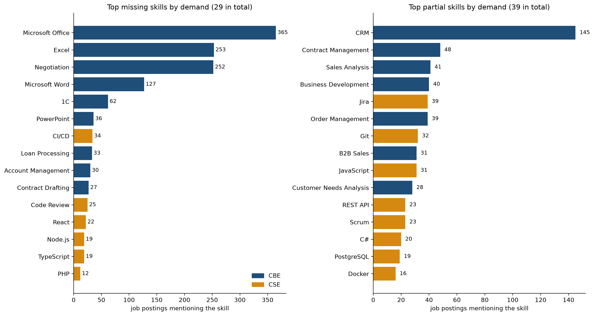
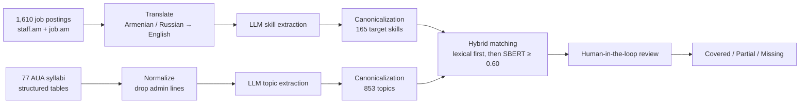
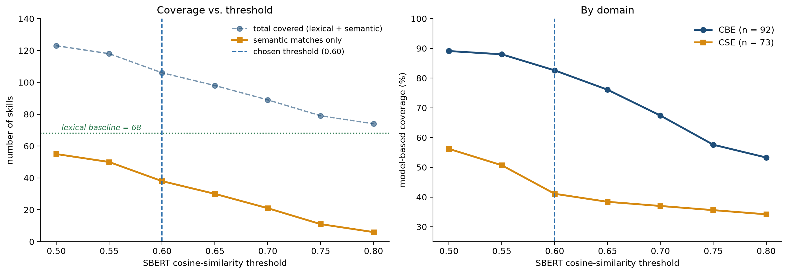

# Curriculum–Labor Market Alignment

**Do AUA's computer science and business syllabi teach the skills Armenian employers ask for?**

This is the code behind my master's capstone at the American University of Armenia.
I collected 1,610 job postings from [staff.am](https://staff.am) and [job.am](https://job.am),
turned them and 77 AUA syllabi into standardized skill and topic lists with LLM-assisted
extraction, and matched the two with a hybrid model: exact lexical matching first,
Sentence-BERT similarity when the wording differs. Every result then went through a
human-in-the-loop review that splits "covered" from "partially covered" and "missing".



## Key results

| | covered | partial | missing |
|---|---:|---:|---:|
| **Hybrid model** (165 skills, binary) | 106 (64.2%) | – | 59 |
| **After review** (3-class) | 97 | 39 | 29 |
| &nbsp;&nbsp;Business & Economics (CBE, 92 skills) | 70 | 12 | 10 |
| &nbsp;&nbsp;Computer Science & Engineering (CSE, 73 skills) | 27 | 27 | 19 |

* **CBE looks well aligned.** 89% of its in-demand skills are covered or partially covered.
* **CSE's gap is mostly about tools, not concepts.** Only 37% of CSE skills are covered outright, but another 37% are partial. Syllabi tend to describe the underlying concept, while employers ask for specific tools like React, Docker, CI/CD or PostgreSQL by name.
* **The most-requested "missing" skills are workplace basics**: Microsoft Office (365 postings), Excel (253), negotiation (252). They're probably used in class but never written into a syllabus, which is as much a documentation gap as a teaching one.



## How it works



**1. Collection.** Category-based scrapers for both job boards. staff.am exposes its data as
Next.js JSON, so the scraper reads that directly; job.am is plain HTML with section headers
in three languages, so its parser recognises "Requirements" / "Պահանջներ" / "Требования" alike.

**2. Extraction and canonicalization.** Armenian and Russian postings were translated to
English with the Google Translate API. `gpt-4.1-mini` then pulls concrete skills out of each
posting. On the curriculum side, each syllabus is reduced to its description, topics and
learning outcomes, with administrative lines ("Midterm", "Spring break") dropped
([`syllabi.py`](src/skillgap/syllabi.py)), and the same model extracts 8–15 primary topics per
course. GPT-4o then maps every raw phrase to a short canonical label, so "MS Excel",
"Microsoft Excel" and "Excel skills" all become *Excel*. Tool names are kept specific on
purpose: employers ask for *PostgreSQL*, not *databases*. All prompts are in
[`src/skillgap/prompts.py`](src/skillgap/prompts.py).

**3. Hybrid matching** ([`src/skillgap/matching.py`](src/skillgap/matching.py)). For each skill:
- **Lexical match.** Every meaningful token of the skill must appear in a syllabus topic: *Cloud Computing* needs both "cloud" and "computing", and the single-letter skill *R* only matches a topic where "R" is a separate word, not any word that starts with R. The skill's own department is checked first, then the other department.
- **SBERT.** If there's no lexical match, `all-MiniLM-L12-v2` embeddings and cosine similarity find the closest topic; ≥ 0.60 counts as covered.

Lexical matches are fully traceable, so they always win. SBERT only decides what's left (97 of 165 skills).

**4. Choosing the threshold.** There's no ground truth for "is this skill taught", so I
checked how sensitive coverage is to the cutoff instead (notebook 02). Moving from 0.60 to
0.65 drops 8 semantic matches; going down to 0.50 adds 17, many of them loose. 0.60 is a
practical operating point, not a proven optimum, which is why step 5 exists.



**5. Review layer** ([`src/skillgap/validation.py`](src/skillgap/validation.py)). The binary
model can't tell "taught" from "a related topic exists". For each skill an LLM (Claude
Sonnet 4.6) read the candidate courses' syllabus text and proposed covered / partial / missing with a one-line
reason. I checked every suggestion and assigned a gap type, and the final status follows
from it:

| gap type | final status | count |
|---|---|---:|
| Lexical coverage | covered | 67 |
| Semantic coverage | covered | 30 |
| Partial / documentation gap | partial | 39 |
| Teaching gap | missing | 29 |

## Repository layout

```
├── notebooks/
│   ├── 01_hybrid_matching.ipynb        # runs the model, applies the review layer, writes results/
│   ├── 02_threshold_sensitivity.ipynb  # how coverage moves with the SBERT cutoff
│   └── 03_results_and_figures.ipynb    # headline numbers and all figures
├── src/skillgap/
│   ├── scrapers/   staffam.py, jobam.py
│   ├── corpus.py       # merge, clean and de-duplicate scraper exports
│   ├── syllabi.py      # normalize syllabi into one text per course
│   ├── llm.py          # skill / topic extraction + canonicalization
│   ├── prompts.py      # every prompt used in the study
│   ├── matching.py     # hybrid lexical + SBERT matcher
│   └── validation.py   # review layer and gap-type → status mapping
├── scripts/            # command-line entry points for each pipeline stage
├── tests/              # unit tests for the matching logic
├── results/            # skill_coverage.csv, threshold_sensitivity.csv, figures/
└── data/               # notes on the inputs, which are not shared (see data/README.md)
```

## Running it

```bash
git clone https://github.com/sarkiskalikian/curriculum-labor-market-alignment.git
cd curriculum-labor-market-alignment
pip install -r requirements.txt
pytest                       # unit tests, no downloads needed
```

Notebooks **02** and **03** run straight from `results/skill_coverage.csv`. Notebook **01**
and the full pipeline need the private inputs described in [`data/README.md`](data/README.md).
On the original data the code reproduces the thesis exactly:

| step | check |
|---|---|
| `build_corpus` on the 26 scraper exports | 1,610 postings (1,023 staff.am + 587 job.am), extraction text identical for all 1,610 |
| `normalize_syllabi` on the two syllabus tables | 77 courses, extraction text identical for all 77 |
| notebook 01 (hybrid matching) | 106 / 59 before review, 97 / 39 / 29 after; every score and best-matching topic identical |

To build a new corpus from scratch:

```bash
python scripts/scrape_jobs.py staffam --category 1 --out data/raw/staffam_software.csv
python scripts/build_corpus.py data/raw/*__translated_EN.csv --out data/interim/jobs_corpus.csv
export OPENAI_API_KEY=...        # read from the environment, never stored
python scripts/extract_skills.py data/interim/jobs_corpus.csv --out data/interim/jobs_skills.csv
python scripts/extract_topics.py data/private/BUS_Syllabi.csv data/private/CSE_Syllabi.csv --out data/private/syllabi_topics_canonicalized.csv
python scripts/run_matching.py --skills ... --syllabi ... --out data/private/matching_results.csv
```

## Limitations

- **Syllabi aren't classrooms.** This measures what is *documented*. A tool used heavily in assignments but never named in the syllabus will show up as a gap.
- **Online postings aren't the whole labor market.** They over-represent firms that hire online, and this sample leans toward business roles.
- **Translation adds noise**, mostly for idiomatic business phrases; tool names translate cleanly.
- **Canonical topics lose some tool-level detail.** The review layer catches many of these cases, but not all.
- **Soft skills are out of scope.** Communication, teamwork and leadership need a different method (learning outcomes, rubrics).
- **The review layer is assisted human judgment, not ground truth.** "Partial" means related evidence exists, not that the skill is fully taught.
